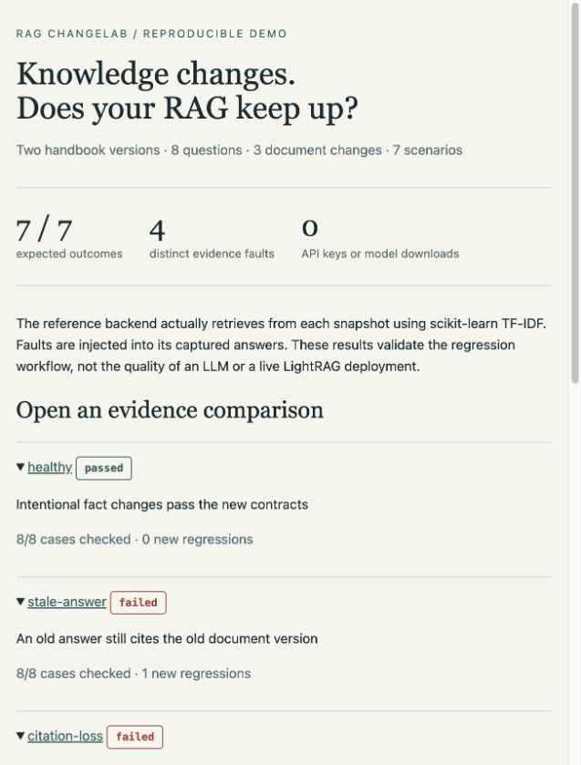

# RAG ChangeLab

**Turn a knowledge-base update into a reviewable answer-and-evidence regression test.**

A handbook changes “30 days” to “7 days”. Your RAG still answers “30 days”, or gives
the new answer while citing an old chunk. A generic answer-similarity score can
miss the distinction between an intended fact change and a regression.

ChangeLab binds two document snapshots to two sets of answer contracts. It traces
source changes through baseline retrieval/citation dependencies, checks the
affected answers against the new facts and evidence, and produces a standalone
HTML comparison plus a machine-readable CI decision.

The first integration is [LightRAG](https://github.com/HKUDS/LightRAG). The core also
accepts captured JSON from other RAG systems through a small Python backend protocol.

## Try it in a minute

Python 3.11+; no API key or model download is needed for the demo.

```bash
python -m pip install -e '.[demo,dev]'
rag-changelab demo --out reports/demo
```

Open `reports/demo/index.html`. The demo actually retrieves from two versions of
an eight-document handbook using scikit-learn TF-IDF, then injects four distinct
faults. It also demonstrates impact selection and automatic escalation.



| Scenario | Result | Queries checked |
| --- | --- | --- |
| Intended retention/authentication updates and a removed legacy route | passed | 8 / 8 |
| Old answer and old source hash | failed | 8 / 8 |
| Correct answer with its citation removed | failed | 8 / 8 |
| Answer cites the deleted legacy source | failed | 8 / 8 |
| Citation quotes text absent from the source | failed | 8 / 8 |
| Impact selection: 3 dependents + 1 sentinel | inconclusive | 4 / 8 |
| A sentinel fails and triggers a full retest | failed | 8 / 8 |

These are controlled workflow checks, not an LLM-quality benchmark or a live
LightRAG deployment result. Replay a captured failure and inspect the CI exit code:

```bash
rag-changelab check reports/demo/stale-answer/suite.json --out reports/replay
# exit 1; reports/replay/index.html explains the failed contracts and evidence
```

## The contribution

The unit of testing is a **knowledge change**, with explicit expectations for both
versions. ChangeLab combines:

1. **Content-bound artifacts.** A SHA-256 digest binds a snapshot to its relative
   source paths and exact UTF-8 text. Plans also bind the suite and baseline run,
   so changing a question or reusing a stale artifact is rejected.
2. **Evidence dependency planning.** A NetworkX graph connects sources to baseline
   queries through retrieved sources, actual answer citations, and required sources.
   Modified/deleted sources select their dependent queries. Added or unmapped sources
   conservatively force a full retest.
3. **Version-aware checks.** Required/forbidden answer text, required citations,
   source deletion, source hashes, and exact quote membership receive separate
   diagnostics. Unknown evidence stays unknown.
4. **Adaptive sentinel controls.** Impact mode samples reproducible queries outside
   the known dependency set. A failed or unavailable control expands a live run to
   the whole suite, without querying already captured cases twice.
5. **Honest coverage gates.** Full mode is the default. A clean subset remains
   `inconclusive` unless the caller explicitly accepts `scoped_pass`.

This is an independently implemented workflow built on established libraries.
It complements broader RAG evaluation frameworks; it does not claim a new semantic
evaluation metric or universal regression detection.

## Use with LightRAG

Prepare the exact text corpus you expect each deployment to contain. In v0.1,
snapshots include UTF-8 `.md` and `.txt` files with relative paths as source IDs.
Preprocess other formats into canonical text first.

```bash
rag-changelab snapshot corpus-v1 --name handbook-v1 --out artifacts/before.json
rag-changelab snapshot corpus-v2 --name handbook-v2 --out artifacts/after.json
```

Write `artifacts/cases.json`:

```json
{
  "cases": [{
    "case_id": "retention",
    "question": "How long are audit logs retained?",
    "before": {
      "contains": ["30 days"],
      "must_cite": ["retention.md"]
    },
    "after": {
      "contains": ["7 days"],
      "excludes": ["30 days"],
      "must_cite": ["retention.md"]
    }
  }]
}
```

Text contracts use case-insensitive substring matching. Choose precise phrases;
there is no implicit semantic judge. If the intended result is abstention, set
`evidence_required: false` and specify the expected abstention text.

LightRAG's `file_path` can be an absolute server path. Map exact paths explicitly
in `artifacts/aliases.json`; ChangeLab does not guess by basename:

```json
{"/documents/retention.md": "retention.md"}
```

Capture the baseline while the v1 deployment is available:

```bash
# LIGHTRAG_API_KEY is optional for servers that allow anonymous queries.
rag-changelab capture artifacts/before.json artifacts/cases.json \
  --url http://localhost:9621 --aliases artifacts/aliases.json \
  --out artifacts/baseline.json
```

Create `artifacts/suite.json`. All paths are relative to this manifest:

```json
{
  "before_snapshot": "before.json",
  "after_snapshot": "after.json",
  "cases": "cases.json",
  "before_run": "baseline.json"
}
```

After updating your LightRAG deployment to v2, run the full gate:

```bash
rag-changelab run artifacts/suite.json --url http://localhost:9621 \
  --aliases artifacts/aliases.json --out reports/current
```

For a lower-cost exploratory run:

```bash
rag-changelab run artifacts/suite.json --url http://localhost:9621 \
  --aliases artifacts/aliases.json --mode impact --audit-controls 5 \
  --out reports/impact
```

`run` captures only the selected questions and automatically expands on bad
sentinels. `check` replays already captured JSON and cannot capture missing cases.
For replay, add `"after_run": "candidate.json"` to the manifest.

```bash
rag-changelab plan artifacts/suite.json --mode impact --out artifacts/plan.json
rag-changelab capture artifacts/after.json artifacts/cases.json \
  --url http://localhost:9621 --aliases artifacts/aliases.json \
  --plan artifacts/plan.json --out artifacts/candidate.json
rag-changelab check artifacts/suite.json --mode impact --out reports/replay
```

| Exit | Decision | Meaning |
| --- | --- | --- |
| 0 | `passed` | All suite cases were checked and the declared checks passed |
| 0 | `scoped_pass` | Clean subset, explicitly accepted with `--allow-scoped-pass` |
| 1 | `failed` | At least one candidate answer/evidence check failed |
| 2 | input error | Invalid artifacts, configuration or local input |
| 3 | `inconclusive` | Unknown comparison, missing capture, or unchecked cases |

An existing candidate failure still fails CI, but is labeled `existing_failure`
rather than `regression`. Baseline failure → candidate pass is `improved`.

## Evidence and integration limits

- The adapter uses documented non-streaming `POST /query`, requesting
  `include_references` and `include_chunk_content`. It parses numeric `[1]` and
  `[1, 2]` answer references. Custom citation styles need a different normalizer.
- Retrieved references and answer-cited sources are separate. Returning a source
  inventory alone does not satisfy an answer's citation requirement.
- LightRAG currently returns chunks without document version hashes. The adapter
  preserves those chunks and never manufactures a hash from the expected snapshot.
  Matching quotes show compatibility with the expected text, not an attestation
  of the server's complete index or document version.
- A source ID without a quote or hash is `unknown`. Unmapped source paths are also
  `unknown`; removed known sources, wrong hashes and unsupported quotes fail.
- Quote membership does not prove that a source entails an answer. Substring
  contracts do not measure semantic completeness or paraphrase equivalence.
- An existing source can change dense retrieval for unrelated questions. Sentinels
  cannot guarantee detection. Skipped cases remain visibly unchecked by default.
- Queries may consume the configured server's LLM budget. Capture does not ingest,
  delete, rebuild, or otherwise mutate the server's corpus. API keys come from an
  environment variable and are excluded from captured artifacts.
- Snapshots, answers and reports contain corpus text. Store/share them accordingly.

## Extend it

Implement `name: str` and `observe(case, snapshot) -> Observation`, then call
`run_candidate` or `capture`. See [the backend example](examples/custom_backend.py).
The core depends on Pydantic, NetworkX and HTTPX. Only the offline demo requires
scikit-learn. No LightRAG server package is imported into your test process.

```bash
python -m pytest -q
ruff check .
python experiments/scheduler_audit.py --out reports/scheduler-audit.json
```

The audit is a seeded **synthetic dependency-oracle experiment**. It measures
scheduling and coverage behavior, not real retriever recall, latency or cost.
The CI runs tests on Python 3.11–3.13 and validates demo outcomes.

## Related infrastructure

- [LightRAG](https://github.com/HKUDS/LightRAG): first HTTP integration and source of the public API contract.
- [NetworkX](https://networkx.org/): provenance graph traversal.
- [Pydantic](https://docs.pydantic.dev/): strict portable artifacts.
- [HTTPX](https://www.python-httpx.org/): HTTP capture.
- [scikit-learn](https://scikit-learn.org/): model-free extractive demo.

No third-party source code is vendored. See [CONTRIBUTING.md](CONTRIBUTING.md) for
test expectations and [docs/design.md](docs/design.md) for the decision rules.

MIT License · Bohan Su
